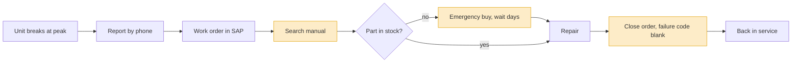
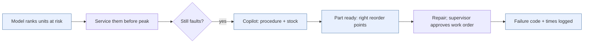

# 🛠️ GSE Availability Copilot

**Live demo:** [tobinjohnson.github.io/gse-availability-copilot](https://tobinjohnson.github.io/gse-availability-copilot/) (runs in your browser, ~20–30 s to load)

**Keeps airport ground-support equipment (GSE) in service: finds where repair time goes, fixes spare-part stocking, predicts which units will fail next, and gives technicians an AI copilot for repairs.**

Built from what I saw in 7 years of GSE maintenance in airline ground operations (2015–2022): belt loaders, tugs and ground power units breaking at peak, and repairs stuck for days waiting for a part. This project rebuilds that problem with today's process-mining and AI tools.

> All data is synthetic: 300 fictional units at three stations, 18 months of SAP-style work orders and stock. The *structure* (SAP PM work orders, SAP MM reorder points, failure codes, procedures) mirrors a real ground-handling maintenance operation.

Companion project: [Turnaround Delay Assistant](https://github.com/TobinJohnson/turnaround-delay-assistant) recovers a delay *after* equipment fails; this one stops the equipment failing.

---

## What it finds (in the simulated data)

| Finding | Number |
|---|---|
| Share of repair time spent waiting for a spare part | **~45%** |
| Repairs that waited on a stock-out | 21% (avg **111 h** down vs 26 h) |
| Units causing half of all downtime | ~25% of the fleet |
| SAP reorder points that are too low | 41 of 51 |
| Work orders closed with the failure code blank | 30% |
| Riskiest 10% of units (model) vs average | fail at **~2×** the average rate |

## The six tabs

| Tab | What it does | Method |
|---|---|---|
| Fleet overview | Availability, downtime Pareto by unit and by part | Pareto (80/20) |
| Where repair time goes | Rebuilds the work-order process from timestamps; shows the bottleneck | Process mining: event log, directly-follows graph, variants |
| Spare parts | Recalculates every reorder point from real usage and lead time | Reorder point = d × L + z·σ·√L |
| Failure risk | Ranks units by chance of failing in the next 7 days | Logistic regression, tested on 13 unseen weeks |
| Technician copilot | "What's wrong and is the part in stock?" → procedure, part status, draft work order | RAG: TF-IDF retrieval over procedures + stock lookup; Claude agent when an API key is set |
| Business case | Annual value from fewer delays, fewer standby units, fewer emergency buys | Editable assumptions, measured inputs |

## Process: before and after





**Human in the loop:** the copilot only reads data and drafts. A supervisor approves every work order; it never releases a unit, changes a procedure or orders parts. Answers come only from the procedures it retrieved, with sources shown.

## Run it

```bash
python3 -m venv .venv && source .venv/bin/activate
pip install -r requirements.txt
python data_generator.py     # regenerate data/*.csv (optional, already included)
streamlit run app.py
pytest -q                    # 8 tests, no API key needed
```

Set `ANTHROPIC_API_KEY` to let Claude write the copilot answers (a few cents per question). The hosted demo has no key and uses retrieval only.

## Files

```
gse.py              fleet, failure modes, parts, lead times (the domain)
data_generator.py   18 months of SAP-style work orders, stock and weekly unit features
process_mining.py   event log, step times, variants, directly-follows graph
spares.py           reorder-point recalculation and downtime Pareto
predict.py          7-day failure-risk model
copilot.py          procedure retrieval, stock check, Claude agent with read-only tools
manuals/            example repair procedures (fictional, for the demo)
app.py              Streamlit dashboard
index.html          runs the dashboard in the browser (stlite) for GitHub Pages
```

## Limitations and next steps

- Synthetic data; a real version reads SAP PM notifications/orders and SAP MM stock, plus GSE telematics for run hours.
- Weekly failure prediction is noisy (AUC ~0.6): good for ranking what to service first, not for certainty.
- Process mining here is hand-built with pandas so it runs in the browser; on real logs, Celonis or PM4Py would add conformance checking.
- The procedures are short examples. Real ones come from OEM manuals.
